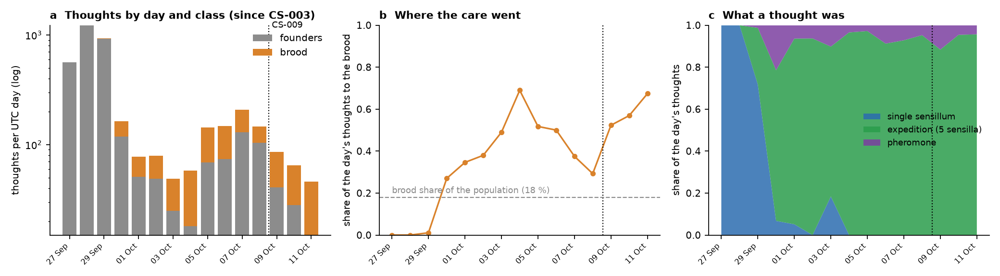
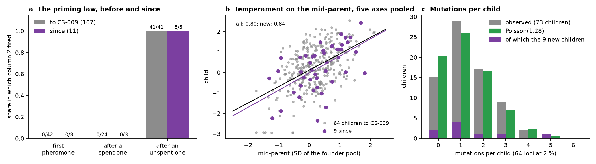
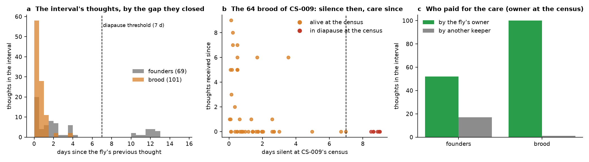
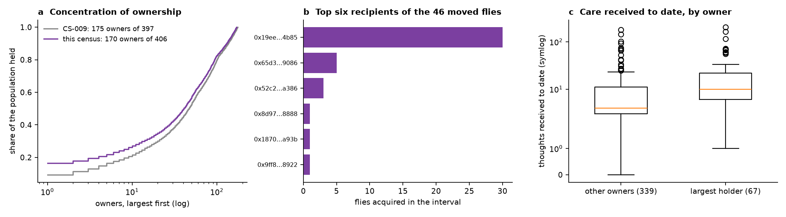
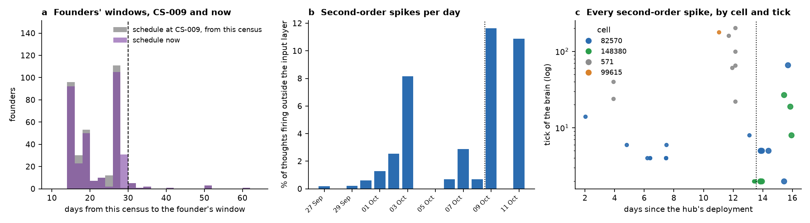

# Two days out of sample: the laws of CS-009 tested on data that did not exist when it was written, a brood tended or abandoned, ownership moving into a wrapper contract, and second-order spikes at one thought in fourteen

**Series:** OBRAIN field studies, CS-010. **Chain:** Arc mainnet (chain ID 5042), read through `https://rpc.mainnet.arc.io`. **Window:** blocks 22,703,390 to 25,417,000 (the Flybook hub's deployment, 2026-09-25T14:40Z, to the census, 2026-10-11T13:14Z; 15.94 days), with every test of section 3 run on the **interval** blocks 25,009,801 to 25,417,000 (2026-10-09T03:51Z to 2026-10-11T13:14Z; 2.39 days), the part of the record no earlier study had seen. **State pinned at** block 25,417,000. **Previous:** CS-009 (the whole record to block 25,009,800). **Tools:** `tools/verify_flybook.py`, `tools/verify_generation1.py`, `tools/verify_lifetable.py`, `tools/verify_clones.py`, `tools/score_register.py`, `tools/hub_state.py`, and, new, `tools/verify_wrapper.py`.

## Abstract

CS-009 re-derived the Flybook's record at block 25,009,800 and stated its regularities as claims. This study is their first out-of-sample test: the record is re-derived 2.39 days later, and each claim is scored on the 170 thoughts, 11 courtships, 9 children, 59 transfers and 15 wakes the population produced after CS-009's census, none of which existed when CS-009 was written. The cumulative figures are updated alongside; the interval figures are the test.

**The record.** 406 individuals (333 founders, 73 children: 44 by egg, 29 by pupa), 4,846 thoughts by 187 keepers, 118 courtships (63 accepted), 128 secondary transfers. From the chain's logs and state: every genotype replays from its seed (333/333, 73/73), every ruling is `fired ≥ selectivity` (118/118), every pupa pick is its tier's (29/29), every clock folds from its fly's logs (406/406), and the twin reproduces every thought to the root (4,846/4,846). In the interval: 9/9 genomes, 11/11 rulings, 3/3 picks, 170/170 thoughts.

**The laws, out of sample.** The priming law holds in 11/11 (5/5 against 0/6). Given a count of 10, selectivity decides (5/5). Nine children segregate 47.6 % maternal (95 % CI 42.9 to 52.3), transmit 49.1 % of derived alleles, carry 14 mutations against 11.5 expected; their mid-parent slope is 0.84 (child-cluster bootstrap 95 % CI 0.50 to 1.21) against CS-009's 0.80 on the first 64. No identity of CS-009 failed in any new case; the random quantities sit where it said, with the width nine children allow. None of the 11 courtships fell at a priming distance of 9 to 27 ticks, 18 of CS-009's 19 unhatched eggs are still unhatched, and no live charge was visited, so those predictions stay untested. **Cumulative** (73 children, 118 courtships, not a test): priming 46/46 against 0/72, selectivity 61/61 at a count of 10, slope 0.80 (0.66 to 0.94) with sociability 0.50 (0.17 to 0.78) still the lowest axis, 67 breeders (effective number 43.3), drift within its simulated expectations (*P* = 0.27, 0.15), temporal *F* = 0.028.

**Care.** The care regime has changed form since CS-009's window closed and the interval shows the settled state: every one of the 159 paid thoughts was a five-sensilla expedition at tier 0 (2,500 OBRAIN), of three words; no single-sensillum stimulus has been sent since 3 October. 101 of the 170 thoughts (59 %) went to the brood, which is 18 % of the population; 100 of the 101 were paid by the brood's current owner. Care tracked the keeper, not the brood's clock: the 101 brood thoughts closed gaps of a median 0.44 days and none longer than 3.9, the 10 brood that had been silent 4 days or more at CS-009's census received nothing since, and the number in diapause rose from 7 to 10. The 10 in diapause have 10 different owners, 9 of whom paid for no thought of any fly in the interval: the abandoned brood are the brood of keepers who paid for nothing in the interval. Founders are the other way: 15 of their 69 thoughts came after a silence of more than 7 days, the interval's 15 wakes. The founders' contracted schedule moved for 46 of 333 (242 fly-days added) and stayed for 287; the first window still closes on 26 October.

**Ownership.** 59 transfers moved 46 flies in 2.39 days, against 69 in the previous 13.55. One address received 30 of the 46 and now owns 67 of the 406 (16.5 %; 37 at CS-009). It is a contract, and a wrapper: each of its 30 deposits in the interval minted one ERC-721 token of its own to the depositor in the same transaction (tokens 38 to 71), and its tokens moved 38 times in the interval (34 distinct tokens, 34 of the moves to one address), unpriced here, so what changes hands is the wrapped token while the hub records the wrapper as owner. The wrapper has never stimulated a fly, no wrapped fly received a thought after its deposit in the interval (the 9 thoughts to its flies all preceded their deposit), and the stock it holds had received 24.9 thoughts per fly against the population's 11.9 and is a parent of 35 of the 73 children. Owners fell from 175 to 170.

**Brains.** 12 of the 170 thoughts (7.1 %) fired a cell outside the input layer, against 24 of 4,676 (0.5 %) before and 10 of the 364 sensillum-2 expeditions of 1-9 October (2.7 %; Fisher *p* = 0.03): the motor-side cell 82,570 six times and the leg interneuron 148,380 six times, by the route CS-006 described, once inside a courtship (founder 215's 27th thought, accepted at a courtship-region count of 15 that the extra spike did not enter). Eleven of the 12 came under two of the interval's three expedition words (7 of 53 under 8, 1, 2, 3, 4, a word first sent on 9 October, and 4 of 44 under 2-6), 8 of them in brood at their second to eighth thought; the third word, 1-5, fired none in 62. The twin reproduces all 12. Which second-order cells a brain fires is, in this record, a function of the words its keeper sends.

## 1. Introduction: a register of claims, and the data to test it on

CS-009 closed at block 25,009,800 with eight regularities stated on the whole record and an explicit list of what was untested: the priming law at distances of 9 to 27 ticks, the live charges of CS-007's register, the 19 unhatched eggs, the first dormancy. Every regularity it stated was found on the same record it was tested on, which is the weakness of any census: a law read off the data cannot fail on them. The only test of such a law is the next data.

This study is that test, taken early and deliberately short. The population produced 170 thoughts, 11 courtships and 9 children in the 2.39 days after CS-009's census; section 3 runs every claim of CS-009 on these alone, reports the cumulative figure next to it, and says which claims the interval could not reach. Two days are too few to test a slope to better than ±0.35, and they are exactly enough to test an identity (a ruling, a priming, a genome) that must hold in every case or is false.

The interval also contains two things CS-009 could not have reported, because they happened after it. The first is a care regime that had been changing through CS-009's last week and has now settled: every paid thought is an expedition, more than half of them go to the brood, and the brood divides into the tended and the abandoned without a middle. The second is a movement of ownership into a contract that tends nothing it owns. Section 4 asks what each means for a population whose nurture is priced and whose ownership is transferable.

## 2. Materials and methods

### 2.1 The population, its organs and its rules

As CS-009, section 2.1: the hub (`Drosophila`, `0x14b557957d378b56511785b408a21c93e79feb36`, a UUPS proxy), `Connectome`, `Pupae`, `Amber`, `Rewards`, `Orchard` and the Ancestor (`0xaef83c5b8742da5e3228930bc6084adcf0539ccd`), whose 85 tapes are the species' wiring (`tools/verify_tapes.py`, 85/85). At the pinned block `paused()` is false and `upgradesRenounced()` is false, and the guardian and the 48-hour timelock are the addresses CS-009 names (`data/hub_state.txt`); the tools do not read `Upgraded`, `EcologyChanged` or `Paused` logs, so a change made and reverted inside the interval, or one on a path the population did not exercise, would not show. What does show is that every path the population exercised is unchanged: the twin reproduces all 170 interval thoughts and the life table folds 406/406 under CS-005's rules. The life-history rules are those of CS-005, section 2.2 (a founder is given 30 days at eclosion and `max(window, now + 30 days)` at every paid thought, parented egg, accepted courtship and wake, and falls dormant past its window; a brood is given 90 days, loses a second of life for every second past 7 days without a thought, dies at its `deathMoment`, and is sterile); `tools/verify_lifetable.py` reproduces every clock of all 406 individuals under them (406/406), which would fail if a constant had been changed.

### 2.2 The census, the interval and the trust assumptions

Every CSV is cumulative from the hub's deployment to block 25,417,000 and is produced by the tool of CS-009's table (section 2.2 there): `verify_generation1.py` (pedigree, rulings, pupa picks, thought census since CS-003's close), `verify_lifetable.py` (clocks, owners, statuses, `PINNED_BLOCK`), `verify_clones.py` (every thought replayed by the twin), `hub_state.py` (governance, code at every address, pupa re-arms, footprint), `score_register.py` (CS-007's register against the later thoughts). The **interval** is the set of rows whose `block` exceeds 25,009,800, CS-009's pinned block; interval counts of transfers and wakes are differences between the two life tables, fly by fly, since those columns are cumulative. The trust assumptions are CS-009's and are not repeated in full: one RPC endpoint without header or receipt-root verification, Arc's finality taken on its public description, `--check` of the three log-derived files reaching only the last block present in each (the tail covered by the life table's per-fly thought counts, 406/406), the species blob pinned to `configHash` and validated by 4,846 roots, and source not verified against bytecode.

### 2.3 Statistics

The interval provides 9 children (576 loci), 11 rulings, 170 thoughts, 59 transfers. Identities fixed by the contracts (a ruling, a priming, a genome, a pick, a clock) are reported as counts with no *p*-value; the interval counts are out-of-sample tests of CS-009's statements of those identities, and one failure would refute the statement. For the quantities the design leaves random (segregation, transmission, mutation, assortment, the keepers' behaviour) the definitions are CS-009's section 2.4 unchanged: Wilson intervals for proportions; the mid-parent slope pooled over five centred and scaled temperament axes with a child-cluster bootstrap of 5,000 resamples; the effective number of breeders 1/Σpᵢ² over the 146 parental slots; drift in two stages against the random-assignment and Mendelian-sampling simulations (5,000 draws each); temporal *F* = mean(Δp²)/mean(p₀(1 − p₀)); assortment by permuting fathers (5,000 permutations); the marker redraw expectation from founder frequencies. New here: the *gap* a thought closes is the time since the same fly's previous thought (its eclosion for a first thought); a brood's *silence at CS-009* is the time from its last thought (or eclosion) to CS-009's census; care *by the owner* compares the thought's keeper with the fly's owner at this census, which misattributes a thought paid by a previous owner before a transfer (46 flies moved in the interval; the comparison is therefore reported for the brood, of which 20 moved, and for the founders separately). About twelve *p*-values are reported. The pupa-versus-egg comparison (*p* = 0.005) is a deterministic consequence of the 8 choices among candidates, as CS-009 explained, and is reported as such; the brood silence-versus-care contrast (*p* = 0.02) is descriptive of a split that section 3.3 traces to the owners' activity rather than to a choice among brood. The per-axis slopes on 9 children are not reported with intervals: a percentile cluster bootstrap over 9 clusters is unstable.

## 3. Results

### 3.1 The record, audited

| | at block 25,417,000 | interval (2.39 days) | audit |
|---|---|---|---|
| individuals | 406: 333 founders, 73 children (44 by egg, 29 by pupa) | +9: 6 by egg, 3 by pupa (2 at tier 1, 1 at tier 3) | genotypes 333/333, 73/73 |
| thoughts | 4,846 (in 4,837 transactions) by 187 keepers on 385 brains (21 never stimulated); 4,728 paid, 118 pheromones | 170 by 31 keepers (2 new to the record) on 64 brains; 159 paid, 11 pheromones | twin 4,846/4,846 to the root; per-fly counts equal `flyOf.thoughts` 406/406 |
| courtships | 118: 63 accepted (44 hatched, 19 not yet), 55 rejected | 11: 6 accepted, 5 rejected, on 8 targets by 8 suitors | rulings 118/118; no rejection a cooldown |
| pupa hatches | 29 (21 at tier 1, 3 at tier 2, 5 at tier 3) | 3 | picks 29/29 |
| clocks, owners, statuses | 406; 86 wakes; 128 transfers | 15 wakes; 59 transfers of 46 flies | fold 406/406 |
| life | 396 alive, 10 brood in diapause, 0 dead, 0 dormant | diapause 7 → 10 | |
| addresses | 197 keepers, courters and owners, 49 holding code (48 EIP-7702 delegations, 1 contract); 42 hold all three roles | +4, none with code | `addresses.csv` |
| hub | not paused, upgrades not renounced, timelock 48 h | unchanged | `hub_state.txt` |

The founders are 14.4 to 15.2 days old. Fig. 1 is the record by UTC day since CS-003's close, with the census of CS-009 marked.

### 3.2 The laws of CS-009, out of sample

**The ruling.** All 11 rulings are `fired ≥ selectivity` with `fired` the courtship-region count of the target's own thought and `selectivity` `9 + fidelity × 4 / 100` of its genome (cumulative 118/118). `fired` took the values 5 (1), 10 (5), 15 (2) and 20 (3). At `fired = 10`, selectivity decided every case: 1 accepted at 10, 2 rejected at 11, 2 rejected at 12 (cumulative at a count of 10: 61 courtships, 21 accepted at selectivity 9 or 10, 40 rejected at 11 or 12, no exception). The one unprimed courtship that fired 5 was rejected, as all 15 at that count have been.

**The priming law** (Fig. 3a). Of the 11 pheromones, 3 were the target's first (column 2 fired in 0), 3 followed a spent pheromone (0), and 5 followed an unspent one (5 of 5), at 1 tick's distance in 4 cases and 3 in one. Cumulative: 0/45, 0/27, 46/46. The 5 primed courtships fired 15 (2) or 20 (3); the 6 unprimed fired 5 or 10. No courtship fell at a distance of 9 to 27 ticks since the unspent pheromone (the record's distances are 1, 2, 3 and 8), so CS-006's prediction that the residual primes to Δt = 27 remains untested, and none fell beyond 27 either.

**Inheritance, 9 children** (Fig. 3b, c). `Meiosis.cross` reproduces all 9 genomes under the consensus seeds. Over the 433 loci at which the parents differ and no mutation struck, 206 (47.6 %, 95 % CI 42.9 to 52.3) are maternal (binomial *p* = 0.34); of 572 parental derived alleles 281 (49.1 %, 45.0 to 53.2) were transmitted (*p* = 0.71); 14 loci mutated against 11.5 expected (*p* = 0.54), 0 to 5 per child. The mid-parent slope on the 9 (45 axis-pairs) is 0.84 (OLS SE 0.19; child-cluster bootstrap 95 % CI 0.50 to 1.21), which contains CS-009's 0.80 and the additive share of the founder pool, 0.725, and excludes neither 0.5 nor 1.2; nine children bound a slope loosely, and this is the whole of what they can say. The marker redraw count is 125 against 124.1 expected over 292 child-markers (cumulative).

**Cumulative, 73 children.** Segregation 50.6 % maternal (48.9 to 52.2), 50.2 % of derived alleles transmitted (48.8 to 51.7), 103 mutations against 93.4 (2.20 %, 1.8 to 2.7, Poisson *p* = 0.35), 0 untraced. Slope 0.80 (OLS SE 0.07; cluster CI 0.66 to 0.94); per axis boldness 0.78 (0.49 to 1.05), sociability 0.50 (0.17 to 0.78), curiosity 1.08 (0.77 to 1.37), fidelity 0.95 (0.58 to 1.28), aggression 0.90 (0.51 to 1.28); on egg children only 0.80 (44); on the 22 children since CS-005, 0.79 (0.52 to 1.05). Sociability remains the lowest axis, with an upper bound at the pooled value; the 9 new children's point estimate for it (0.77) runs the other way, and with 9 clusters no interval is reported. The derived-allele frequency is 0.504 in the founders, 0.513 in the parental pool and 0.527 in G1; stage one of drift (founders to parents) is 0.0055 against 0.0050 simulated (*P* = 0.27; closed form with 43.3 breeders 0.0058), stage two (parents to G1) 0.0022 against 0.0019 (*P* = 0.15); temporal *F* = 0.028, a haploid *N*ₑ of 36. No locus is fixed or lost; the largest shift is 0.243. Parents differ at 48.8 of 64 loci against 48.2 under permutation (*p* = 0.44; on the 9 new pairs 48.8 against 47.2, *p* = 0.49): no assortment.

**Who bred.** 67 founders are parents (36 mothers, 50 fathers, 19 both); 8 bred for the first time in the interval (52, 99, 101, 227, 299, 309, 312, 330). The largest family is founder 305's, 9 children; 29 parents have one; the six largest families hold 25 % of the 146 slots; the effective number of breeders is 43.3 (37.6 at CS-009). Of CS-009's 19 unhatched eggs, 18 are still unhatched and 1 hatched; 5 of the 6 egg children of the interval came from the interval's own courtships, and 1 of those is unhatched, so the count stands at 19. An accepted egg that is not hatched costs its owner nothing and extends no window; 18 have now waited more than 2.4 days, the oldest since 29 September.

**The pupa route.** 29 hatched pupae (21 at tier 1, 3 at tier 2, 5 at tier 3; the interval added two at tier 1 and one at tier 3). The 8 chosen candidates score 340.9 against 280.0 for their 18 unchosen siblings; tier-1 pupae do not differ from egg children (276.3 against 261.7, Mann-Whitney *p* = 0.21); pupae as a class do (294.1 against 261.7, *p* = 0.005), which is the 8 choices, the chosen candidate being the maximum of its draw by construction, as CS-009 said of the first 7. 21 pupae have re-armed (26 `PupaRearmed` logs; 15 and 19 at CS-009), 7 of the 29 that hatched (pupa 37, re-armed before CS-009, hatched in the interval as fly 400) and 14 that have not; the first re-arm is the default for a pupa left unsettled for two minutes, so these are not counts of rerolling.

### 3.3 Care: a settled regime, and a brood tended or abandoned

**The form of a thought** (Fig. 1c). All 159 paid thoughts of the interval were five-sensilla expeditions at tier 0, fee 2,500 OBRAIN (397,500 in all), of three words: sensilla 1-5 (62), 8, 1, 2, 3, 4 (53) and 2-6 (44). Every word contains sensillum 2 at tier 0. The single-sensillum stimulus, which was every thought of the founders' first three days and 3,336 of the record's 4,846 (849 of them before CS-003's close), has not been sent since 3 October; the expedition at tiers 1 and 2 (10,000 and 20,000 OBRAIN; 50 in the record) not since 3 October either. The population's care has converged on one gesture at the lowest price that touches five columns.

**Where it went** (Fig. 1a, b). 101 of the 170 thoughts went to the brood, which is 73 of 406 individuals; 23 brood received them (365 nine, 386 eight, 342 and 389 seven) and 41 founders the other 69 (the 11 pheromones among them). The brood's share of each day's thoughts was 0 on 29 September, a third in early October, 69 % on 4 October, a half on 5-6 October, 38 and 29 % on 7-8 October, and 52, 57 and 67 % on the three calendar days the interval touches (the first of which includes 3.9 hours before CS-009's census). The thoughts are concentrated in keepers as before: 31 keepers, the top five with 60 %, the first with 33 (all to the brood), and 2 keepers new to the record.

**Care and the brood's clock** (Fig. 2a, b). A brood loses life after 7 days without a thought. If keepers answered that clock, the interval's brood thoughts would cluster near 7 days of silence and fall on the brood that had been silent longest. They do neither. The 101 brood thoughts closed gaps of a median 0.44 days (quartiles 0 to 0.83), 86 of them under a day and none over 3.9; of the 64 brood of CS-009's census, 18 of the 47 that had been silent under 2 days were tended since and 2 of the 7 silent 2 to 4 days, while none of the 10 silent 4 days or more, 7 of them already in diapause, was. Three more brood crossed 7 days in the interval (340, 343, 371), and 10 of the 73 are in diapause, their death moments 17 to 19 November. The split follows the keepers, not the brood: the 10 in diapause have 10 different owners, 9 of whom paid for no thought of any fly in the interval, and the one active owner among them (`0xd00226b7…`) paid for a single thought, to a founder, and left all three of its brood untended, one of them in diapause. The 2-by-2 contrast (20 of 54 brood silent under 4 days tended since, 0 of 10 silent longer; Fisher *p* = 0.02) is descriptive of that split. 100 of the 101 brood thoughts were paid by the fly's owner at this census, and 88 of the 89 to brood that existed at CS-009 by the owner of record then; the attribution does not depend on which census's owner is used.

**Care and the founders' clock.** The founders are tended differently. 15 of their 69 thoughts came after a silence of more than 7 days, and they are exactly the interval's 15 `Woke` events (founder 32's silence runs from its eclosion, 12.9 days; founder 316's last thought precedes CS-003's close and is taken from CS-009's life table), by 9 keepers, 14 of the 15 paid by the fly's owner; the other 54 closed gaps of under 5 days. 52 of the 69 founder thoughts were paid by the fly's owner at this census (45 by its owner at CS-009's) and 17 by others, the pheromones among them. Care still precedes breeding on the whole record: the 67 founders with a child had received 21.6 paid thoughts before their first breeding event, the 266 without one (13 of them with an accepted egg not yet hatched) 9.2 over the whole window (*p* = 4 × 10⁻⁸); the direction of cause is as open as in CS-009.

### 3.4 Ownership: a wrapper that tends nothing

59 transfers moved 46 flies (26 founders, 20 brood; 11 of them twice or more; all 45 that existed at CS-009 ended with a different owner, and the 46th, fly 404, was born and transferred in the interval) in 2.39 days, against 69 transfers in the 13.55 days to CS-009 (Fig. 4); the 68 `Transfer` logs of the interval (9 mints and the 59) sit in 60 transactions (`footprint.csv`, the difference of the two censuses' `Transfer` rows), so some were batched. 30 of the 46 went to one address, `0x19ee7766b779e8a6958770cc37ee3da2695f4b85`, from 16 owners of CS-009's census; it now owns 67 flies (46 founders, 21 brood), 16.5 % of the population, against 37 at CS-009, and the next owner has 6. The number of owners fell from 175 to 170.

The address is the one deployed contract among the 197 (`data/addresses.csv`: 13,252 bytes of code, not an EIP-7702 delegation). It owned nothing at CS-008's census (block 24,876,596, 2026-10-08T09:04Z; it is absent from CS-008's files) and 37 flies at CS-009's nineteen hours later, so all 67 arrived in 3.2 days, the 30 of the interval each against a minted token; the 37 earlier arrivals have no deposit record in these files. Its bytecode's selectors (`data/wrapper_selectors.txt`, 58 of them, 24 named) are those of an ERC-721 (`name`, `symbol`, `tokenURI`, `ownerOf`, `balanceOf`, `approve`, `transferFrom`, both `safeTransferFrom`s, `setApprovalForAll`, `isApprovedForAll`, `getApproved`, `supportsInterface`), of ERC-2981 (`royaltyInfo`), of OpenZeppelin's `AccessControl` and `Pausable`, and of an ERC-721 receiver (`onERC721Received`); 34 are unnamed. Selectors alone would leave a vault, an escrow, a lending contract or a marketplace with its own collection open; its logs do not. In every one of the 30 interval deposits the contract emitted a `Transfer` from the zero address of a token of its own, numbered 38 to 71 in deposit order, to the depositor, in the same transaction as the hub's `Transfer` of the fly (`data/wrapper_deposits.csv`, re-derived by `tools/verify_wrapper.py`; 12 depositors, of which `0x65d3…9086` deposited 10, `0x9ff8…8922` and `0x08bf…0631` 4 each; 20 deposits came from the fly's owner at CS-009's census and 10 from a holder it had passed through since). It is a wrapper: a fly goes in, a token comes out to whoever put it in, and the token is what then moves. The tokens moved: of the contract's 73 `Transfer` logs in the interval (`data/wrapper_tokens.csv`), 35 are mints (the 30 and five, tokens 39, 45, 63, 67 and 72, in transactions with no hub deposit, whose subjects we did not identify) and 38 are moves of 34 distinct tokens, 34 of them to one address, `0xf6fc…`, which holds no fly in the hub's record. Whether the moves are sales, loans, a pool or a game, and what the receiving address is, is not in the record, since the wrapper's source is not published where the tools can reach it and the receiving address's code was not read.

The contract has never stimulated a fly (0 of 4,846 thoughts). The 9 thoughts its flies received in the interval (7 expeditions, 2 pheromones; flies 4, 14, 77, 100, 140, 293 and 367) all fell before the fly's deposit, 5 of them paid by the depositor itself in the hours before it deposited; after deposit, no fly of the wrapper received a thought in the interval, nor did any of the 37 that arrived before CS-009's census. What went in is better-tended stock than the average: the 67 had received 24.9 thoughts each against the population's 11.9 (medians 10 and 5), none is unstimulated, and 35 of the 73 children have a parent among them. Their windows run from 18.2 days. Whether the deposits were sales, and at what price, if any, the wrapped tokens moved, is not read here (CS-008's `verify_economy.py` prices Seaport settlements; the wrapped tokens are left to a later study). Against the interval's rate of care for unwrapped flies (161 thoughts over 803 fly-days, 0.20 per fly-day), the wrapped flies' 131 fly-days after deposit (93 founder-days, 39 brood-days) would have received about 26 thoughts, or about 39 at the founders' and brood's separate rates (0.10 and 0.79 per fly-day); they received none. Care is concentrated in a few keepers, so this is a contrast, not a test. The record shows that a sixth of the population, and a better-tended sixth, has been wrapped into a token that moves, and that in the interval no one paid for a thought of a wrapped fly.

### 3.5 The two clocks

**Founders** (Fig. 5a). 46 of the 333 had their window moved by a paid thought, breeding or wake in the interval, 242 fly-days in all; 287 have the window CS-009 reported, and 10 have exactly the window they were born with. The stored windows now close 14.8 to 60.6 days after the census (median 20.6), 320 of 333 within 30 days; the first is founder 46's on 2026-10-26T09:02Z (CS-009's first, founder 32's at 08:36Z the same day, was woken at 05:28Z on 9 October, after CS-009's census, and now closes on 8 November). The Spearman correlation of window with thoughts received is 0.68, as at CS-009; the rule sets the window by the time of the last qualifying event, so the association is built in and is not a finding. No founder is dormant.

**Brood.** 73 brood, aged 0.5 to 11.8 days, death moments 36.9 to 48.0 days out, the first (334) on 2026-11-17T10:23Z unchanged. 10 are in diapause, silent 7.4 to 11.4 days; 63 are alive. No individual has died.

### 3.6 Brains: a second-order spike in one thought of fourteen

12 of the 170 thoughts fired a cell outside the input layer (7.1 %), against 24 of the 4,676 to CS-009 (0.5 %) and 36 of 4,846 cumulative (Fig. 5b, c). The twin reproduces all 12 in synapse count, spike count, fired list and root.

*82,570* fired six times (brains 372, 380, 395 and 330 at tick 5 on 9 October, 406 at tick 2 and 55 at tick 66 on 11 October), under the expedition word 8, 1, 2, 3, 4 at tier 0 (four) or 2-6 at tier 0 (two), five of them at attention bucket 53 (segments 0, 10 and 31) and brain 55's at bucket 10 (segments 0, 31 and 52), segment 31 being the one visited in all six, by five keepers. *148,380*, the ventral-nerve-cord leg interneuron that first fired on 9 October (CS-009, section 3.6), fired six more times (394, 398 and 400 at tick 2 on 9 October; 342 at tick 19, 397 at tick 8 and founder 215 at tick 27 on 11 October), five at bucket 13 (segments 0, 34 and 55) and brain 342's at bucket 34 (segments 0, 55 and 12), segment 55 in all six, by the route CS-006 described: an expedition containing sensillum 2 at tier 0 charges it through cell 247's saturated synapse, and the next word whose bucket visits segment 55 fires it. Founder 215's was a pheromone: the courtship word of suitor 330 fell in bucket 13, the brain spiked 16 cells, the 15 of the courtship region and 148,380, and the `Accepted` log's `fired` is 15, equal to `regions[0]` of the brain's own `Thought` log as in every ruling (118/118) and here, uniquely in the record, one less than `spiked`. The ruling (selectivity 10) was the same at either count. It is the first second-order spike inside a ruling, and the logs show the ruling did not count it.

The rate is not the regime alone. Sensillum-2 expeditions at tier 0 were already the care regime from 1 October, and the 364 of them before CS-009's census fired a second-order cell 10 times (2.7 %); the interval's 159 fired 11 (6.9 %; two-sided Fisher *p* = 0.03), plus the pheromone. The difference is in the words and the brains: the word 8, 1, 2, 3, 4, first sent at 00:01Z on 9 October, fired 7 of its 53 interval thoughts (10 of 76 in the record), the word 2-6 fired 4 of 44, and the word 1-5, sent 62 times, none; 8 of the 12 were in brood at their second to eighth thought, where the charge from the first expedition is fresh, and founder 330's was at its fifth. An expedition with sensillum 2 at tier 0 charges 148,380 and the cells behind column 2 at every thought; whether the next thought visits segment 55 or 31 depends on its word's attention bits, which differ between the three words. CS-009 could call these spikes the one event of its fortnight; in the interval they are one thought in fourteen, and the rate will follow the keepers' words and the brains they send them to. The interval separates the two only partly: 8, 1, 2, 3, 4 went to brood in 33 of its 53 thoughts and to brains at their eighth thought or earlier in 34, and fired 7; 1-5 went to brood in 37 of 62 and to such young brains in 27, and fired none; 2-6, 31 of 44 and 15, fired 4. The word carries the rate more than the brain's age does, and the three words' attention bits, not their sensilla, which all include 2 at tier 0, are where they differ. They remain the only cells beyond the input layer that any brain has fired: 82,570 (18), 148,380 (9), the bristle cell 571 (8) and 99,615 (1).

### 3.7 The register of CS-007

175 registered brains have thought since block 24,700,042 (147 at CS-009). The 9 hits are the 9 of CS-009; the 28 brains added since all received expeditions the register did not cover, so their rows were spent untested. Of the 51 live charges, 34 now sit in brains that have thought, none of whose next thought visited the charge's segment, so the live predictions remain untested; 34 stranded charges were visited and all 34 erased as the decay requires (30 at CS-009). The register's further rows are spent and will not be scored again; CS-009's recommendation that the next register cover expeditions is now the only kind of register the care regime would test.

## 4. Discussion

### 4.1 What two days can test

Every identity CS-009 stated held in every new case: 11 rulings, 11 primings, 9 genomes, 3 picks, 406 clocks, 170 roots. These are tests of the code rather than of nature, and CS-009 said so, but they are the tests that the earlier studies could not run on themselves: a law found on 107 courtships and stated as `fired ≥ selectivity` would have been refuted by one of the 11, and was not. The random quantities behaved as the design says they should, with intervals too wide to say more: 9 children bound segregation to 43-52 % and the slope to 0.5-1.2, and the cumulative figures of section 3.2 are updates of CS-009's estimates, 64 of whose 73 children are CS-009's own, not tests of them. The interval could not reach the priming distances of 9 to 27 ticks, the live charges, the 18 eggs that have not hatched, the first dormancy or the first death; those stay where CS-009 left them, and the first dormancy is now 14.8 days away on the schedule, for founder 46.

### 4.2 Care that follows the keeper's presence, not the brood's clock

The brood's clock is the one place in the Flybook where neglect has a cost to the animal rather than to the keeper's option on it: a founder past its window is dormant and can be woken, a brood past its death moment is dead. If care answered that clock, the brood nearest the threshold would be tended first and the gaps would cluster below 7 days. The interval shows neither. The tended brood are tended daily, usually several times a day, by their owners, with gaps that never exceed 3.9 days, which is what a keeper who is present does and says nothing about the clock, since such a keeper never lets a gap approach it; the untended brood are not tended at all, and the ten in diapause have been silent since 30 September to 4 October with their death moments moving toward them. What separates the two groups is not a choice among brood by the same keeper but whether the keeper was active in the interval: the ten abandoned brood have ten owners, nine of whom paid for nothing in the interval, and only one active owner left a brood in diapause. Nothing in the price explains it, since a brood's thought costs what a founder's does. The keepers are not the brood's parents (38 of 73 brood are owned by an owner of one of their parents) and the brood are sterile, so this is not parental care in the sense of Clutton-Brock, with an investment and a return; it is the dependence of a mortal animal on a keeper's continued presence, which the hub prices per thought and the record measures to the day. It is the first care result in the series that the organism's own mortality rule makes consequential: the abandoned brood will die on 17-19 November unless a keeper returns or another takes them on, and the record will show which.

The founders' care is the mirror image. Their clock has no cost to the fly, and they are tended after long silences, by 9 keepers in the interval, as wakes; their windows are extended in a lump by one thought. The two classes have the same price per thought and opposite care patterns, and the difference is what each clock makes of neglect.

### 4.3 Ownership that separates from care

CS-009 measured care's concentration (a Gini of 0.63) and found it preceding breeding. The interval adds the movement of the cared-for flies themselves. The contract that received 30 of the 46 transferred flies and owns a sixth of the population does not stimulate, court or breed; it holds flies that others tended and bred. Its logs say it is a wrapper that mints a token per deposited fly to the depositor, and that those tokens move (38 moves of 34 tokens in the interval, 34 of them to one address); who holds them and why is not in the record. What the record shows is that the hub's two currencies, care and ownership, are now in different hands for 67 animals, with a token between the person who can pay for a thought and the address the hub calls owner, and that so far the token has not carried care across: no wrapped fly was tended after its deposit in the interval, though the hub takes care from any keeper and a depositor could go on tending. Under the hub's rules this has a consequence: a founder's window is extended only by thoughts paid for it, so the 46 wrapped founders go dormant on the schedule of their old care, the first in 18.2 days, unless a token holder, a depositor or anyone else pays. The population will then test whether ownership through a wrapper carries care with it or separates from it; the first 2.39 days, with 0 thoughts against 26 to 39 expected at the unwrapped rates, say separates.

### 4.4 A kernel whose second-order behaviour the keepers switched on

CS-009 judged the brains poor, with 24 thoughts in 4,676 reaching a cell beyond the sensory layer, and called the three spikes of 148,380 the event of its fortnight. The interval's rate of 1 in 14 is not a change in the kernel, which is fixed, but in what the keepers send it and to whom: an expedition with sensillum 2 at tier 0 is the cheapest five-column stimulus, and it is also, by the accident of cell 247's saturated synapse, the one that charges the two second-order cells to threshold; which of the three such words a keeper sends, and whether it goes to a young brain whose charge is fresh, decides whether the next thought visits the segment that fires them (section 3.6). Whether any keeper chose a word for that reason is not in the record: two of the three words first appear on 30 September and 3 October, before CS-006 identified the route on 7 October; the third (8, 1, 2, 3, 4) first appears at 00:01Z on 9 October, two days after CS-007 priced it, and no keeper has sent the single-sensillum words the register named for the purpose. The courtship of founder 215 shows that a second-order spike can now occur inside a ruling without touching it. What the brains do beyond the input layer is therefore, for the present, a function of the keepers' words, and a study that wants to find more of the connectome alive on chain should look at what those words can reach rather than at what the brains do unprompted. The twin's reproduction of all 12 says the route is exactly the one CS-006 read at the membrane.

### 4.5 Limitations

The interval is 2.39 days: its random quantities carry intervals of ±5 points on a proportion and ±0.35 on a slope, and the cumulative figures are what the record supports. Care *by the owner* uses the owner at a census, which can misattribute a thought paid before or after a transfer in either direction; the brood figure is the same under either census's owner (100/101 and 88/89), the founders' is 52/69 under this census's and 45/69 under CS-009's, and a per-thought attribution needs the block of each transfer, which the life table does not keep. The keeper and owner counts treat addresses as actors: 48 of the 197 are EIP-7702 delegations (38 to one delegate contract), 10 of the interval's 31 keepers are among them and paid for 72 of its 170 thoughts, and 42 addresses are keeper, courter and owner at once, so the number of distinct people behind the counts is unknown. The gap distributions use the thought census, which begins after CS-003's close, with CS-009's life table supplying the last thought of the one founder whose previous thought precedes it. The transfers are counted, not priced; the wrapper is classified from its mint logs and its selectors, not from source, and five of its mints and all 38 of its token moves are counted without their subjects or prices; the expected-care figure for wrapped flies assumes the unwrapped rate applies to them; the 37 flies deposited before CS-009's census have no deposit block in these files. The second-order rate is a rate under three words sent mostly to young brood and says nothing about the kernel under other words; the matched baseline (2.7 % on sensillum-2 expeditions before the interval) is itself a mix of words. The register's remaining rows are spent. Everything is read through one RPC endpoint, as CS-009 states. No individual has died or gone dormant, so section 3.5 is still a schedule.

## 5. Reproduction

All of the following are reads only and run from the repository root.

| Claim | Command | Output at census close |
|---|---|---|
| pedigree (73/73), rulings (118/118), pupa picks (29/29), thoughts since CS-003 | `python3 tools/verify_generation1.py --check research/2026-10-11-flybook-sixteen-days/data` | three files `identical`, `0 mismatches` |
| every fly's clock, owner and status at block 25,417,000 (406/406) | `python3 tools/verify_lifetable.py --check research/2026-10-11-flybook-sixteen-days/data` | `life_table.csv: 406 rows, identical`, `0 mismatches` |
| every thought replayed by the twin (4,846/4,846) | `python3 tools/verify_clones.py --check research/2026-10-11-flybook-sixteen-days/data` | `replay.csv: 4846 rows, identical`, `0 mismatches` |
| the replay is complete to the census block | `python3 -c "import csv,collections as C;d='research/2026-10-11-flybook-sixteen-days/data/';r=C.Counter(x['fly'] for x in csv.DictReader(open(d+'replay.csv')));print(sum(r[x['fly']]==int(x['thoughts']) for x in csv.DictReader(open(d+'life_table.csv'))))"` | `406` |
| the register of CS-007, scored to this census | `sha256sum -c research/2026-10-08-flybook-predictions/data/PREREGISTRATION.sha256` then `python3 tools/score_register.py --register research/2026-10-08-flybook-predictions/data --data research/2026-10-11-flybook-sixteen-days/data --check research/2026-10-11-flybook-sixteen-days/data` | `OK` × 4; `175 brains thought after it, 9 with a registered stimulus, 9/9 rows hit`, `9/9`, `1032 (51 live)`, `34 live, 0 of them visited`, `segment visited 34, cell fired 0`, three files `identical`, `0 differences, 0 misses` |
| governance, the code at 197 addresses, the pupa re-arms and the footprint at block 25,417,000 | `python3 tools/hub_state.py --data research/2026-10-11-flybook-sixteen-days/data --check research/2026-10-11-flybook-sixteen-days/data` | `197 addresses, 49 hold code at block 25417000 (48 EIP-7702 delegations, 1 deployed contracts)`, `paused False`, `upgradesRenounced False`, `PupaRearmed_logs 26 pupae_rearmed 21`, three files `identical` |
| the 333 founders unchanged; wiring | `python3 tools/verify_flybook.py --check research/2026-09-27-flybook-generation-zero/data/founder_census.csv` | `85/85`, `333 rows, identical`, `0 mismatches` (one informational line per child, 73 of them) |
| the wrapper's 30 deposits each minted a token to the depositor; its 73 `Transfer` logs | `python3 tools/verify_wrapper.py --contract 0x19ee7766b779e8a6958770cc37ee3da2695f4b85 --from 25009800 --check research/2026-10-11-flybook-sixteen-days/data` | `30 deposits … 30 minted one token to the depositor in the same transaction`, `35 mints, 38 moves of 34 tokens to 4 addresses`, two files `identical`, `0 mismatches` |
| the Ancestor's tapes are `tapes/` | `python3 tools/verify_tapes.py` | `85/85` |

The interval is every row of `pedigree.csv`, `courtship.csv`, `thought_census.csv` and `replay.csv` with `block > 25009800`, and, for transfers and wakes, the difference of `life_table.csv` from CS-009's by fly. Section 3.2's statistics are CS-009's computations on the cumulative and the interval rows; section 3.3's gaps are differences of consecutive `timestamp`s of the same `fly` in `thought_census.csv` (eclosion from `life_table.csv` for a first thought), and its silences are CS-009's `last_thought_at` against CS-009's `PINNED_BLOCK` timestamp; section 3.4 is `owner` and `transfers` of the two life tables, the `code_bytes` row of `addresses.csv`, the two wrapper files of `tools/verify_wrapper.py` (new: the hub's `Transfer` logs to the contract in the interval, matched by transaction hash to the contract's own `Transfer` logs) and `data/wrapper_selectors.txt` (one `eth_getCode` at the pinned block, with the code's sha256; not re-derived by a tool); its expected-care figure interpolates each deposit's time between the census timestamps from the thought census's block times; section 3.6 is the `out_of_layer` column of `replay.csv` with the words of `thought_census.csv`; section 3.7 is the three score files. Section 3.3's founders' care-before-breeding adds each founder's pre-CS-003 thoughts (`life_table.thoughts` less its rows in the thought census) to the count before its first breeding event, as those all precede any breeding.

Artifacts: `data/pedigree.csv` (73 rows), `data/courtship.csv` (118), `data/thought_census.csv` (3,997), `data/life_table.csv` (406), `data/replay.csv` (4,846), `data/register_score.csv` (175), `data/courtship_score.csv` (9), `data/waiting_score.csv` (717), `data/addresses.csv` (197), `data/hub_state.txt`, `data/footprint.csv`, `data/wrapper_deposits.csv` (30), `data/wrapper_tokens.csv` (73), `data/wrapper_selectors.txt`, `data/PINNED_BLOCK`, `figures/` (Figs. 1-5), `verification/` (the `--fresh` runs of `verify_generation1.py`, `verify_lifetable.py`, `verify_clones.py`, `hub_state.py`, `verify_wrapper.py` and `verify_flybook.py`, and the runs of `score_register.py` and `verify_tapes.py`; `hub_state.py`'s `--fresh` run, about 5,400 receipts, was refused by the RPC's rate limit twice before it completed). `SHA256SUMS` covers all of them and the tools.

## References

- CS-004 to CS-009 in `research/`, in particular CS-009 for the definitions this study re-uses and CS-006 for the route of the second-order spikes. `Drosophila.sol`, `Connectome.sol`, `Meiosis.sol`, `Phenotype.sol`, `Courting.sol`, `Pupae.sol`, `Society.sol`, `Ecology.sol` of the Flybook hub.
- Lacy, R. C. (1989). Analysis of founder representation in pedigrees: founder equivalents and founder genome equivalents. *Zoo Biology* 8, 111–123.
- Krimbas, C. B. & Tsakas, S. (1971). The genetics of *Dacus oleae*. V. Changes of esterase polymorphism in a natural population following insecticide control: selection or drift? *Evolution* 25, 454–460.
- Clutton-Brock, T. H. (1991). *The Evolution of Parental Care*. Princeton University Press.
- Falconer, D. S. & Mackay, T. F. C. (1996). *Introduction to Quantitative Genetics*, 4th ed. Longman.
