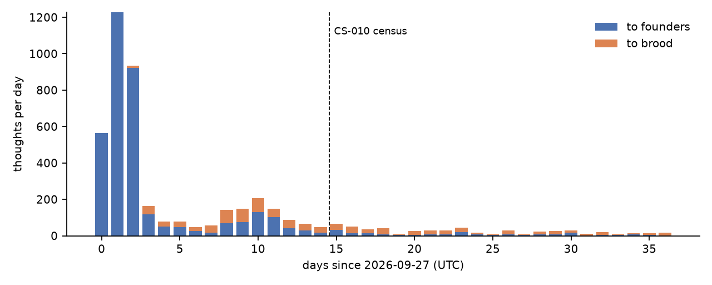
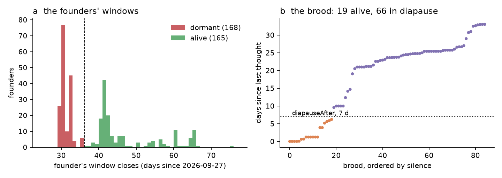
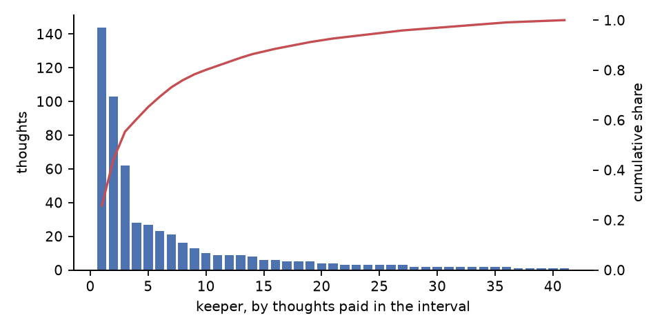

# The first window closes: three weeks out of sample, the dormancy of half the founders, a brood kept by eight owners, and a record that keeps every identity it was given

**Series:** OBRAIN field studies, CS-011. **Chain:** Arc mainnet (chain ID 5042), read through `https://rpc.mainnet.arc.io`. **Window:** blocks 22,703,390 to 29,099,000 (the Flybook hub's deployment, 2026-09-25T14:40Z, to the census, 2026-11-02T04:11Z; 37.56 days), with every test of section 3 run on the **interval** blocks 25,417,001 to 29,099,000 (2026-10-11T13:14Z to 2026-11-02T04:11Z; 21.62 days), the part of the record no earlier study had seen. **State pinned at** block 29,099,000. **Previous:** CS-010 (the whole record to block 25,417,000). **Tools:** `tools/verify_generation1.py`, `tools/verify_lifetable.py`, `tools/verify_clones.py`, `tools/score_register.py`, `tools/hub_state.py`, `tools/verify_wrapper.py`, `tools/verify_flybook.py`, unchanged.

## Abstract

CS-010 tested CS-009's claims on 2.39 days and named what that interval could not reach: the first dormancy, the first window of the founders (closing from 26 October), the brood's first deaths, the unhatched eggs. This study re-derives the record 21.62 days later and scores every claim on the 558 thoughts, 19 courtships, 12 children and 59 wakes the population produced after CS-010's census.

**The record.** 418 individuals (333 founders, 85 children: 49 by egg, 36 by pupa), 5,404 thoughts, 137 courtships (75 accepted), 150 secondary transfers. From the chain's logs and state: every genotype replays from its seed (85/85; 12/12 new), every ruling is `fired ≥ selectivity` (137/137; 19/19 new), every pupa pick is its tier's (36/36; 7/7 new), every clock folds from its fly's logs (418/418), and the twin reproduces every thought to the root (5,404/5,404; 558/558 new). No identity stated by CS-009 or CS-010 failed in any new case.

**The first window closes.** On 26 October the founders' first 30-day windows began to close, and by the census 168 of the 333 founders (50.5 %) are dormant: the first dormancy of the record, and every one of them at exactly the moment the life-history rules of CS-005 give (418/418). The 168 are founders whose last thought fell between 26 September and 2 October (only 2 alive founders last thought that early, their windows pushed by a later `Tended` that was not a thought): none received a thought in the interval, and their 89 owners paid for one thought, of any fly, in 21.62 days. The 165 alive are the tended: their windows run to 11 December, 61 of them were thought in the interval, and 67 of the 70 founders with a child are among them. Dormancy in this record is not a property of a fly; it is the absence of its keeper.

**The brood.** 66 of the 85 brood (78 %) are in diapause, against 10 of 73 at CS-010. The 19 alive belong to 8 owners, two of whom hold 10 of them; 329 of the 348 brood thoughts of the interval went to these 19, every paid one by the fly's current owner (348/348). The silent brood have not thought for 9.6 to 33 days, and their death moments begin on 17 November: the record's first deaths are now scheduled, to the hour, unless their owners return.

**Care and keepers.** The care regime CS-010 described has held: every one of the 539 paid thoughts was a five-sensilla expedition at tier 0 (2,500 OBRAIN). The rate fell to 25.8 thoughts a day (71 in CS-010's interval), 355 in the interval's first half against 203 in its second; 41 keepers paid, and three of them paid 55 %. **Ownership** has nearly stopped moving: 22 transfers of 12 flies in 21.62 days, against 59 of 46 in CS-010's 2.39; the wrapper contract owns 73 flies (67), has still tended none, and its flies received 1 thought in the interval.

**Brains.** 19 of the 558 thoughts (3.4 %, 95 % CI 2.2 to 5.3) fired a cell outside the input layer, against 12 of 170 (7.1 %) in CS-010's interval; 15 of them in brood, cell 571 ten times. As before, the words decide: the word sent most (3, 4, 5, 6, 7; 115 times) fired none, and no pheromone did. CS-007's register: 195 brains have now thought after it, its 9/9 hits stand, none of the 38 live charges in brains that thought has had its segment visited, and of the 36 charges whose segment was visited no cell fired.

## 1. Introduction: the interval that reaches the clocks

Every study since CS-005 has carried the same untested prediction: that the founders, given 30 days at eclosion and 30 more at every paid thought, would begin to fall dormant on 26 October, and that the brood, which lose a second of life for every second past seven days without a thought, would begin to die some weeks after their keepers stopped. Neither could be tested before the clocks ran out. CS-010's 2.39 days were chosen to test identities; this interval, 21.62 days, is long enough to reach the clocks themselves.

It reaches the first of them. Section 3.2 scores the identities again on new data, section 3.3 reports the first dormancy and what separates the dormant from the alive, section 3.4 the brood's division into a kept few and an abandoned many, and section 3.5 to 3.7 the keepers, the owners and the brains. Section 4 asks what a population is when its survival is a ledger of its keepers' attention.

## 2. Materials and methods

### 2.1 The population, its organs and its rules

As CS-010, section 2.1. The tools and the rules are unchanged; a change to a life-history constant would fail the fold (418/418), a change to the brain's kernel the twin (5,404/5,404), and a change to the ruling or to `Meiosis.cross` the generation audit (137/137, 85/85). Dormancy is CS-005's rule: a founder is dormant once the block's timestamp passes its stored `deathAt`, the later of its eclosion plus 30 days and `now + 30 days` at every `Tended`; a dormant founder can be woken by a thought (`Woke`). A brood is in diapause past 7 days without a thought and dies at its `deathMoment`, the midpoint at which the diapause charge would catch up with its 90-day lifespan.

### 2.2 The census, the interval and the trust assumptions

Every CSV is cumulative from the hub's deployment to block 29,099,000 and produced by the tools of CS-010's section 2.2. The interval is the set of rows whose `block` exceeds 25,417,000, CS-010's pinned block; transfers and wakes are the difference between the two life tables, fly by fly. The trust assumptions are CS-010's: one RPC endpoint without header or receipt-root verification, Arc's finality on its public description, the species blob pinned to `configHash`, and source not verified against bytecode. The data were read with a local cache of finalized logs built in the same run; section 5 gives the commands that re-derive them.

### 2.3 Statistics

Identities fixed by the contracts (a ruling, a genome, a pick, a clock, a dormancy) are reported as counts; one failure would refute them. Proportions carry Wilson intervals. The interval provides 12 children (768 loci), 19 rulings and 558 thoughts; that is enough to test identities and to describe the care, and too few children to bound a heritability usefully, so the mid-parent slope is not re-estimated. The *gap* a thought closes is the time since the same fly's previous thought (its eclosion for a first). *Owner* is the owner at this census.

## 3. Results

### 3.1 The record, audited

| | at block 29,099,000 | interval (21.62 days) | audit |
|---|---|---|---|
| individuals | 418: 333 founders, 85 children (49 by egg, 36 by pupa) | +12: 5 by egg, 7 by pupa (6 at tier 1, 1 at tier 2) | genotypes 333/333, 85/85 |
| thoughts | 5,404 | 558 by 41 keepers (4 new to the record) on 93 brains; 539 paid, 19 pheromones | twin 5,404/5,404 to the root |
| courtships | 137: 75 accepted (49 hatched by egg, 26 eggs not laid), 62 rejected | 19: 12 accepted, 7 rejected | rulings 137/137; no rejection a cooldown |
| pupa hatches | 36 | 7 | picks 36/36 |
| clocks, owners, statuses | 418; 148 wakes; 150 transfers | 59 wakes; 22 transfers of 12 flies | fold 418/418 |
| life | 184 alive, 168 founders dormant, 66 brood in diapause, 0 dead | dormant 0 → 168; diapause 10 → 66 | |
| owners | 170 | 170 | |
| addresses | 200 keepers, courters and owners, 50 holding code (49 EIP-7702 delegations, 1 contract) | +3 | `addresses.csv` |
| hub | not paused, upgrades not renounced, timelock 48 h, guardian unchanged; 40 pupa re-arms of 29 pupae | +14 re-arms | `hub_state.txt` |
| footprint | 6,527 logs in 5,948 transactions, 32.46 bn gas, 675.15 native units in fees | +623 logs, +78.8 in fees | `footprint.csv` |

Fig. 1 is the record by UTC day since CS-003's close.

### 3.2 The identities, out of sample

**The ruling.** All 19 rulings are `fired ≥ selectivity`, `fired` the courtship-region count of the target's own thought, `selectivity` `9 + fidelity × 4 / 100` of its genome (cumulative 137/137). `fired` took the values 5 (1), 10 (10), 15 (7) and 20 (1). Every courtship of the interval was between flies alive at the census: no dormant founder was courted or courted.

**Inheritance.** `Meiosis.cross` reproduces all 12 new genomes under the consensus seeds; 380 of their 768 loci (49.5 %) are maternal, and 16 mutated against 15.4 expected (cumulative 119 against 108.8 over 5,440 loci). Seven of the 12 came by pupa, every pick its tier's. Seven of the 12 new children are already in diapause.

**The eggs.** 26 accepted courtships have no laid egg, against 19 at CS-010: the unhatched eggs of CS-009 are still unhatched, and seven more joined them.

### 3.3 The first window closes

The founders' death moments (Fig. 2a) form two populations with nothing between them. 168 fall between 26 and 31 October; every one of those founders is dormant at the census, and every one is at the moment its fold gives (418/418). Their last thoughts lie between 26 September and 2 October, so their windows are the 30 days of their eclosion or of a thought in their first week, never extended. The other 165 have windows from 2 November to 11 December, every one pushed by a later `Tended`.

| founders | n | thought in the interval | thoughts in the interval | owners | owners who paid any thought in the interval | have bred |
|---|---|---|---|---|---|---|
| dormant | 168 | 0 | 0 | 89 | 1 | 3 |
| alive | 165 | 61 | 210 | 75 | 59 | 67 |

The division is between keepers, not between flies: the dormant founders' 89 owners paid for one thought of any fly in 21.62 days, and only 6 of them own any fly still alive. The dormant had received a median of 4 thoughts in their lives, the alive 12. No dormant founder has been woken yet: none has received a thought since its window closed.

### 3.4 The brood: kept by eight owners

At CS-010, 63 brood were alive and 10 in diapause; at this census 19 are alive and 66 in diapause (Fig. 2b). The 19 alive have been silent at most 6.2 days; the 66 between 9.6 and 33 days, a gap without exception at the 7-day threshold. The 19 alive belong to 8 owners (6, 4, 2, 2, 2, 1, 1, 1). Of the 348 thoughts to brood in the interval, 329 went to the 19 alive and 19 to 13 that have since fallen back into diapause; every paid one (348/348) was paid by the fly's current owner. The most-thought brood, 365, received 61 thoughts in the interval.

The 66 silent brood are not dead. Their death moments begin on 17 November 2026 at 10:23 UTC (four on that day) and run into December; any thought before that moment wakes the fly and resets the charge. This is the record's first scheduled death, stated here in advance of the fact and checkable by `tools/verify_lifetable.py` at any later block.

### 3.5 The keepers

The 539 paid thoughts were all five-sensilla expeditions at tier 0, of eight words (each five consecutive sensilla of eight), the commonest 3, 4, 5, 6, 7 (115). The rate fell through the interval, 355 thoughts in the first half against 203 in the second, and the keepers concentrated: 41 paid, and the three most active paid 144, 103 and 62 (55 %; Fig. 3). The thoughts of the interval closed gaps of a median 0.89 days; 62 closed a gap of more than 7 days; the life table counts 59 wakes in the interval, each on a gap past `diapauseAfter` (the fold checks every one).

### 3.6 Ownership

22 transfers moved 12 flies in the interval, against 59 of 46 in CS-010's 2.39 days. The number of owners is 170, as it was. The wrapper contract `0x19ee…4b85` received 6 more flies and owns 73 (17.5 %): 47 alive, 25 brood in diapause, 1 dormant founder. It has still never stimulated a fly, and its flies received 1 thought in the interval. `tools/verify_wrapper.py` finds 7 deposits in the interval, each minting one token of the wrapper's own to its depositor in the same transaction (5 depositors), so one fly left the wrapper; the contract emitted 68 `Transfer` logs (24 mints, of which 17 were not matched to a hub deposit in the interval and are left unexplained here, 44 moves of 32 tokens to 8 addresses, 0 burns). What changes hands is still the wrapped token, not the fly.

### 3.7 Brains: the words still decide

19 of the 558 thoughts (3.4 %, 95 % CI 2.2 to 5.3) fired a cell outside the input layer, against 12 of 170 in CS-010's interval: cell 571 ten times, 99,615 and 82,570 three times each, 61,079, 65,177 and 148,380 once. 15 of the 19 were in brood, at their 2nd to 82nd thought. By word: 6 of 84 under 6, 7, 8, 1, 2; 4 of 64 under 8, 1, 2, 3, 4; 3 of 86 under 4-8; 3 of 50 under 5-8, 1; 1 each of 29, 58 and 53 under the remaining three except 3-7, which fired none in 115; no pheromone fired one. The twin reproduces all 19. Cell 571 had fired 8 times before CS-010's census.

**CS-007's register.** 195 brains have thought since its block 24,700,042; its 9 registered stimuli and 9 courtships hit 9/9 and 9/9, as before. Of the 1,032 waiting charges, 806 are in brains that thought, 38 of them live, and none of the 38 has had its segment visited; 36 charges had their segment visited, and no charged cell fired. The register's predictions of a firing charge remain untested.

## 4. Discussion

### 4.1 What three weeks can test

The interval tested every identity CS-009 and CS-010 stated, on more new cases than either had (19 rulings, 12 genomes, 7 picks, 558 thoughts, 418 clocks), and none failed. It also reached the first of the clocks, which no earlier interval could: dormancy arrived for every founder at the moment the rules gave and for no other. A population biology on a public ledger can state the time of a death in advance; section 3.4 does so.

### 4.2 Survival as attention

The founders divide into two groups that share no fly-level property the record measures and differ completely in their keepers: the dormant founders' owners paid for one thought in three weeks, the alive founders' owners for 210 of them. The brood divide the same way, more sharply, because their clock is shorter: 19 alive in the hands of 8 owners, 66 silent. In this population, what lives is what someone is still paying to think; the rules make no exception and the record shows none.

### 4.3 A record that is slowing

The rate of thoughts fell by two thirds from CS-010's interval and halved again within this one; the keepers are fewer and more concentrated; ownership has nearly stopped moving. Whether this is a population settling to a small committed core or emptying is the question the next census can answer: by 17 November the first brood will have died or been woken, and from 2 November the second wave of founders' windows begins to close (Fig. 2a).

### 4.4 Limitations

As CS-010's section 4.5. In addition: owners are taken at the census, so a thought paid by a previous owner is attributed to the current one (12 flies moved in the interval); the wakes are counted from the life table and not separated by route; the economy of the interval (OBRAIN paid, the price series) is not re-derived here: `tools/verify_economy.py` (CS-008) was not run to this block, and the only economic figure reported is the fee of the paid thoughts (539 at 2,500 OBRAIN each).

## 5. Reproduction

All of the following are reads only and run from the repository root.

| Claim | Command | Output at census close |
|---|---|---|
| pedigree (85/85), rulings (137/137), pupa picks (36/36), thoughts since CS-003 | `python3 tools/verify_generation1.py --check research/2026-11-02-flybook-three-weeks/data` | three files `identical`, `0 mismatches` |
| every fly's clock, owner and status at block 29,099,000 (418/418), the 168 dormant | `python3 tools/verify_lifetable.py --check research/2026-11-02-flybook-three-weeks/data` | `life_table.csv: 418 rows, identical`, `0 mismatches` |
| every thought replayed by the twin (5,404/5,404) | `python3 tools/verify_clones.py --check research/2026-11-02-flybook-three-weeks/data` | `replay.csv: 5404 rows, identical`, `0 mismatches` |
| the register of CS-007, scored to this census | `sha256sum -c research/2026-10-08-flybook-predictions/data/PREREGISTRATION.sha256` then `python3 tools/score_register.py --register research/2026-10-08-flybook-predictions/data --data research/2026-11-02-flybook-three-weeks/data --check research/2026-11-02-flybook-three-weeks/data` | `OK` × 4; `195 brains thought after it`, `9/9`, `806 (38 live, 0 of them visited)`, `0 differences, 0 misses` |
| governance, code at 200 addresses, pupa re-arms, footprint | `python3 tools/hub_state.py --data research/2026-11-02-flybook-three-weeks/data --check research/2026-11-02-flybook-three-weeks/data` | `200 addresses, 50 hold code at block 29099000`, `paused False`, `PupaRearmed_logs 40 pupae_rearmed 29`, three files `identical` |
| the wrapper's deposits and token moves in the interval | `python3 tools/verify_wrapper.py --contract 0x19ee7766b779e8a6958770cc37ee3da2695f4b85 --from 25417000 --to 29099000 --check research/2026-11-02-flybook-three-weeks/data` | two files `identical`, `0 mismatches` |

The interval is every row of `pedigree.csv`, `courtship.csv`, `thought_census.csv` and `replay.csv` with `block > 25417000`, and, for transfers and wakes, the difference of `life_table.csv` from CS-010's by fly. Figures are drawn from the shipped CSVs alone. `verification/` holds the `--check` runs of `verify_generation1.py`, `verify_lifetable.py`, `verify_clones.py`, `verify_wrapper.py` and `score_register.py`, the run of `verify_tapes.py`, and the `--check` run of `hub_state.py`. Unlike CS-010's, these runs read a local cache of finalized logs, headers and receipts built from the chain in the same session, not `--fresh`; a `--fresh` re-run of each command is the stronger audit and is left to the reader. `SHA256SUMS` covers every artifact and the tools.

## References

- CS-005, CS-009 and CS-010 in `research/`, for the life-history rules, the definitions and the interval method re-used here.
- `Drosophila.sol`, `Society.sol`, `Ecology.sol`, `Meiosis.sol`, `Courting.sol`, `Pupae.sol` of the Flybook hub.
- Clutton-Brock, T. H. (1991). *The Evolution of Parental Care*. Princeton University Press.
